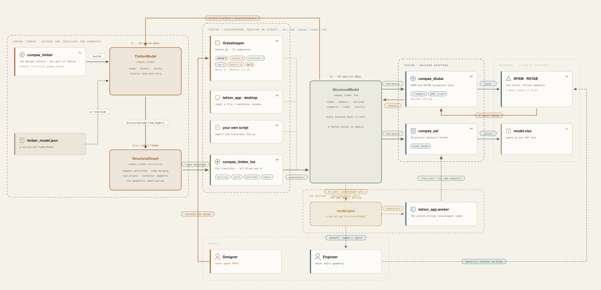

# Tekton

Tekton carries a [COMPAS Timber](https://github.com/gramaziokohler/compas_timber)
design into structural analysis and brings the numbers back onto the beams.
It translates the timber model into a neutral `StructuralModel`, solves it -
with [OpenSees](https://openseespydoc.readthedocs.io/) in-process, or by
pushing to Dlubal RFEM/RSTAB, or by writing a [SAF](https://www.saf.guide/)
spreadsheet - and reads the results back so they land on the design model as
attributes. It checks them against EN 1995 on the way. It is driven from
Grasshopper, a desktop app, a command line, or plain Python.

## System map

<picture>
  <source media="(prefers-color-scheme: dark)" srcset="docs/_images/architecture/tekton-system-map-dark.svg">
  
</picture>

Read it left to right; the round trip runs right to left along the top. Click
the image to open it at full size. The remaining diagrams and the notes behind
them are in [`docs/architecture.html`](docs/architecture.html).

## Packages

The repository is a `uv` workspace holding six packages under `packages/`.

| Package | Role | Runs where |
| --- | --- | --- |
| [`compas_timber_fea`](packages/compas_timber_fea) | The neutral layer: `TimberToStructural` translator, joint and plate policies, units, preflight, serialization, results back onto beams | anywhere, including Rhino's Python 3.9 |
| [`compas_dlubal`](packages/compas_dlubal) | RFEM/RSTAB adapter: gRPC client, object mappers, result reader | Python ≥ 3.10 (the `dlubal-api` floor) |
| [`compas_opensees`](packages/compas_opensees) | OpenSees backend: builder, gmsh plate meshing, analysis loop, result reader. No licence, no desktop application | Python ≥ 3.12 |
| [`compas_saf`](packages/compas_saf) | SAF `.xlsx` exporter | Python ≥ 3.10 |
| [`tekton_app`](packages/tekton_app) | Desktop GUI (PySide6), the `tekton` CLI, and the worker subprocess Grasshopper calls | Python ≥ 3.10 |
| [`tekton_gh`](packages/tekton_gh) | 27 Grasshopper components: author loads, supports and materials, translate, run, results, utilisation, visualise, save and load | Rhino 8 |

The rule that keeps them apart: if a value depends on which software you are
talking to, it lives in an adapter. If it depends on engineering judgement, it
lives in the neutral layer as an explicit, reported policy.

```text
tekton/
├── packages/
│   ├── compas_timber_fea/   # neutral model, translator, policies, results
│   ├── compas_dlubal/       # RFEM/RSTAB via gRPC
│   ├── compas_opensees/     # OpenSees, in-process, licence-free
│   ├── compas_saf/          # SAF export (xlsx)
│   ├── tekton_app/          # GUI, `tekton` CLI, worker subprocess
│   └── tekton_gh/           # Grasshopper components + componentizer
├── docs/                    # Sphinx sources, architecture.html, diagrams
└── tests/
    ├── unit/                # automated, offline (run in CI)
    └── *.py                 # manual scripts against a live RFEM
```

## Requirements

- **Python ≥ 3.10** for everything outside Rhino. The workspace pins 3.12 via
  `.python-version`; `uv` installs it for you.
- **Rhino 8** for the Grasshopper components. Rhino ships CPython 3.9, which is
  why the RFEM client runs in a separate worker process (see the map).
- **Nothing at all** for the OpenSees backend: `openseespy` and `gmsh` come
  with `uv sync` and run inside the worker process. No licence, no key, no
  desktop application.
- **Dlubal API 2.13.8** (pinned) with **RFEM 6.13** or **RSTAB 9.13**, only if
  you push to Dlubal — and Windows, since RFEM is a Windows application. The
  `dlubal-api` client itself installs anywhere; it is the application that is
  the constraint. SAF export needs neither.
- **`compas_timber` from the `structural_graph_plates` branch**, pinned to a
  revision in `pyproject.toml` *and* `requirements.txt` — the two are read by
  different installers, so `install.py` checks that they agree. The released
  COMPAS Timber does not carry `compas_timber.structural`, which Tekton reads.

## Installation

```bash
git clone https://github.com/gramaziokohler/tekton.git
cd tekton
python3 install.py --fix
```

`install.py` is the short way in. It checks every part of the setup, installs
what is missing, and names the fix for whatever it cannot do itself:

```bash
python3 install.py                  # check only, change nothing
python3 install.py --fix            # install what is missing
python3 install.py --fix --build    # ... and build the Grasshopper components
```

It exists because Tekton runs in two Pythons at once — Rhino's 3.9 for the
Grasshopper side, a 3.12 worker for everything that needs gRPC — and the
failure modes all have the same shape: something *is* installed, just not the
thing the other half expects. So it checks the worker environment, the Rhino
venv and the `compas_timber` inside it, that both dependency files pin the
**same** revision, the repo path, the API key and the built components, and
finally runs the test suite as proof that the install works.

The manual route still works, and is what `--fix` calls underneath:

```bash
uv sync --extra dev
```

Run anything through `uv run`, which uses that environment:

```bash
uv run pytest          # automated tests, no RFEM needed
uv run ruff check .    # lint
uv run tekton --help   # CLI
```

For the Grasshopper components, follow
[`packages/tekton_gh/README.md`](packages/tekton_gh/README.md): it covers the
dedicated Rhino venv with the branch build, building the `.ghuser` files, and
the `Tekton Info` component that tells you what is missing.

### API key

Anything that talks to RFEM/RSTAB needs a Dlubal API key. Put it in a `.env`
file at the repository root (copy `.env.example`). `.env` is gitignored; do
not commit it. The worker also accepts `TEKTON_API_KEY` in the environment,
and the GUI takes the key in its settings.

## Usage

### Grasshopper

Build the timber model with the COMPAS Timber components as usual. Tekton
starts where a `TimberModel` sits on the canvas: mark supports, pick a grade,
author load cases and loads, then `Tekton Translate`, `Tekton Preflight` and
`Tekton Run`.

`Tekton Backend` picks where it goes. **`opensees` is the one to start with**:
no licence, no API key, nothing to install beyond the worker environment, and
a model solves in milliseconds rather than the 25 seconds RFEM takes. Use
`rfem` when the answer has to be defensible, or for the design add-on.

Run is button-gated because it rebuilds the backend model from scratch every
time.

Afterwards: `Tekton Results` puts numbers on the beams and warns when they are
older than the model they are wired to. `Tekton Visualize` colours by a
quantity. `Tekton Display` draws the analysis model — supports, loads,
reactions — as a picture. `Tekton Summary` writes the one-page report:
deflections, an equilibrium check, extreme forces, utilisation, and the
assumptions each number stands on.

One habit worth keeping: a placed component keeps the script it was placed
with. After updating Tekton, drop `Tekton Upgrade` on the canvas and press it
once.

### Desktop

```bash
uv run tekton --gui
```

Drop a `timber_model.json`, choose SAF or a live push, and go. This path needs
no Rhino.

### Command line

```bash
uv run tekton timber_model.json --output model.xlsx        # SAF
uv run tekton timber_model.json --dlubal --app rfem        # push to RFEM
```

The worker Grasshopper shells out to is also a CLI. It takes a serialized
`StructuralModel`, not a timber model:

```bash
uv run python -m tekton_app.worker model.json --backend opensees --out result.json
uv run python -m tekton_app.worker model.json --backend rfem --out result.json --design
uv run python -m tekton_app.worker model.json --backend opensees --out result.json --mesh-size 0.25
```

`--mesh-size` is the target edge length for plate meshing, in metres (default
0.5). Finer is slower and eventually pointless — the mesh converges. Note that
the plate outline sets a floor: a target coarser than the spacing of its
vertices cannot win, because those vertices are what keeps neighbouring plates
sharing the same nodes.

### Python

The shortest useful path — translate, solve, check, attach — needs no licence
and no running application:

```python
from compas.data import json_load

from compas_timber_fea.translator import TimberToStructural
from compas_timber_fea.results import attach_results_to_timber
from compas_timber_fea.design import DesignAssumptions
from compas_timber_fea.design.checks import check_model
from compas_opensees import run_model

timber_model = json_load("timber_model.json")

# Supports travel on the beams. Without them preflight refuses the run
# rather than solving a mechanism.
for beam in list(timber_model.beams)[:2]:
    point = beam.centerline.start
    beam.attributes["support_points"] = [[point[0], point[1], point[2], "pinned"]]

translator = TimberToStructural(connector_mode="rigid", material_name="C24",
                                source_units="mm")   # what the timber model is in
structural_model = translator.translate(timber_model)
for line in translator.report:      # every assumption the translator made
    print(line)

runner = run_model(structural_model)          # solves in milliseconds
for line in runner.log:
    print(line)

assumptions = DesignAssumptions(service_class=1)
checks = check_model(structural_model, assumptions)   # EN 1995, no add-on needed

attach_results_to_timber(structural_model, timber_model)
# beam.attributes["analysis"] now holds samples, envelope and provenance
```

`source_units` is worth getting right: nothing in a COMPAS model states its
unit, so a millimetre model translated as metres is off by a factor of 1000 —
and that is silent everywhere except in the results.

For RFEM, swap the solve for the adapter:

```python
from compas_dlubal.dlubal.importer import DlubalImporter
from compas_dlubal.dlubal.result_reader import DlubalResultReader

DlubalImporter(app_type="rfem", delete_all=True).run(structural_model)
structural_model.results = DlubalResultReader(app_type="rfem").read(
    load_cases=[1], calculate=True, structural_model=structural_model
)
```

No file is written on either path: the `StructuralModel` object goes straight
into the adapter. Serialization exists for the Grasshopper split, and for
handing a model to an engineer.

## Status

As of 2026-09-23 the round trip is real for beams **and** plates, through two
independent backends: Grasshopper → OpenSees (milliseconds, no licence) or →
RFEM, and back onto the elements with forces, deformations, envelope,
utilisation and provenance. The plate numbers are calibrated against RFEM —
deflection within 6 %, centre moments within 10 %, reaction sum within 0.1 %.

Utilisation exists twice on purpose: computed here from EN 1995, and read
from RFEM's timber design add-on. Having both is how a wrong one gets caught.

> **⚠ The code tables have not been checked by an engineer.** Every value
> taken from a standard — `k_mod`, `gamma_M`, material strengths, the EN 1990
> psi factors — was transcribed by a developer reading the standard. A wrong
> one produces entirely plausible numbers, and the tests assert against the
> same transcriptions, so they cannot catch it either. They are also the base
> Eurocode recommendations, not a national annex. Use the design numbers for
> orientation while designing, not for verification. See
> [`docs/discussion/design-checks.md`](docs/discussion/design-checks.md).

Still open, in rough order of value:

- **Stability.** Buckling and lateral-torsional buckling are not verified;
  the neutral model carries no buckling length. Every report says so.
- **CLT layups.** Plates are checked as homogeneous isotropic slabs, which is
  unconservative across the layers of a real CLT panel. Every plate result
  carries that caveat.
- **Joint stiffness from the fasteners.** A joint is still rigid or pinned by
  its class name, not by the screws in it.
- **The engineer's edits in RFEM.** Every run rebuilds the model, so they do
  not survive. Needs a persistent identifier map.
- **Tension-only members and prestress.** Not representable today; both make
  the model non-linear, which superposition of load combinations relies on
  not being.

The work packages, with what each one is blocked on, are in
[`docs/discussion/work-packages.md`](docs/discussion/work-packages.md).

## Tests

The automated suite runs offline. It builds real Dlubal protobuf messages and
SAF spreadsheets without connecting to RFEM:

```bash
uv run pytest
```

The scripts directly under `tests/` are manual: they need a running
RFEM/RSTAB instance and the API key, and they report by printing rather than
asserting. Run them individually, for example `uv run tests/test-roundtrip.py`.

## Development notes

### Working against a local compas_timber checkout

To develop against a local clone instead of the pinned revision, add a source
override to the root `pyproject.toml`:

```toml
[tool.uv.sources]
compas_timber = { path = "../compas_timber", editable = true }
```

Then run `uv sync` again. Revert the override before committing.

### iCloud Drive

If the repository lives in iCloud Drive, the workspace packages can suddenly
become unimportable (`ModuleNotFoundError: compas_timber_fea`). iCloud sets
the macOS *hidden* flag on synced files, and Python ≥ 3.12 skips hidden `.pth`
files in site-packages, which is how editable installs are wired up.

```bash
chflags nohidden .venv/lib/python3.12/site-packages/*.pth
```

Durable fix: keep the venv outside iCloud, for example
`export UV_PROJECT_ENVIRONMENT=~/.venvs/tekton` before `uv sync`.

### Building a standalone executable

Building one requires a PyInstaller spec file, which is not part of the
repository at present.

## Documentation

Online documentation, with a tutorial and an API reference:
[gramaziokohler.github.io/tekton](https://gramaziokohler.github.io/tekton).

## Issue tracker

Found a bug or stuck? File an issue on the
[issue tracker](https://github.com/gramaziokohler/tekton/issues).
